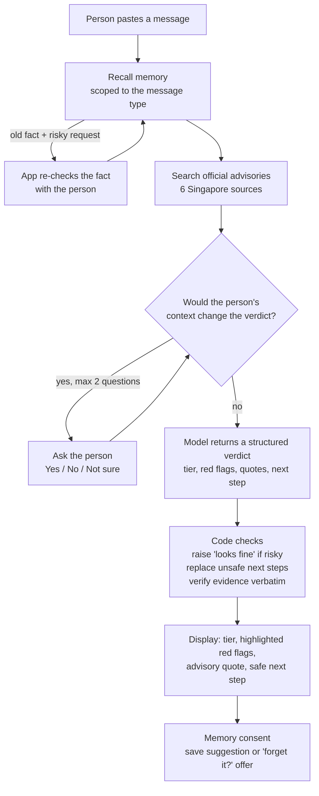

# SecondLook: Routing Scam Checks to Whoever Knows Best

CS619 Human–AI Interaction Design · course project · 2026

SecondLook is an LLM agent that helps a person in Singapore decide what to do about a suspicious text message. It is built and evaluated around one observation: **many scam messages cannot be judged from their text alone.**

"DBS: OTP 482913 is for your SGD 1,240.00 card payment to SHOPEE SG" is genuine if you are paying and fraud in progress if you are not. A delivery notice, a one-time code or a recruiter's message can be word-for-word identical whether it is real or a scam. The deciding fact (did I order this, did I request this code, did I apply for this job) is something only the recipient knows.

So SecondLook splits the work. The AI does what it is good at: spotting technical red flags and grounding them in official advisories. The person contributes what only they know, but is asked only when their answer would change the verdict. Rules enforced in the application, not in the prompt, keep the advice safe when the model makes a mistake.

This repository accompanies the CS619 project report and the 2-minute demonstration video, which are submitted separately. It contains the full code, the datasets, the archived evaluation results behind every number in the report, and the steps to run the app and reproduce the experiments yourself.

## Contents

1. [Three design ideas](#1-three-design-ideas)
2. [System architecture](#2-system-architecture)
3. [Installation and setup](#3-installation-and-setup)
4. [Evaluation](#4-evaluation)
5. [Key findings](#5-key-findings)
6. [Limitations and future work](#6-limitations-and-future-work)
7. [Repository structure](#7-repository-structure)
8. [Reproducibility](#8-reproducibility)

---

## 1. Three design ideas

### Idea 1: Human oversight through contextual clarification (Week 4)

The agent has an `ask_user` tool. When the model calls it, the application **pauses the agent loop**, shows one multiple-choice question (Yes / No / Not sure) with the reason "Your answer changes the verdict", and then resumes the same conversation with the answer. The model is instructed to ask only when the person's situation would change the verdict and red flags have not already decided it.

The application, not the prompt, enforces the limits: at most **two questions per check**, each question must name one of a fixed set of context keys (e.g. `expecting_delivery`), and each answer is bound to that key so memory can use it.

*Code:* `secondlook/agent.py` (`ask_user`, `CheckSession.start/answer`), `secondlook/prompts.py` (step 4), `app.py` (question card).

### Idea 2: Verifiable, risk-tiered verdicts (Week 2)

Instead of "scam / not scam", every verdict is one of four tiers, set by what the message asks the person to do:

| Tier | When | What the person is told |
|---|---|---|
| Looks fine | Nothing risky requested, no red flags | No action needed |
| Probably genuine, verify the safe way | Context fits, but it asks to click, pay, share a code, call or reply | Act only through the official app or a website you type in yourself |
| Likely scam | Clear red flags, or the person's context contradicts the message | Don't act; report to ScamShield or call 1799 |
| Can't tell safely | Not enough evidence | Check through the official channel or hotline |

Each red flag is shown as a highlighted phrase in the message, linked to the official advisory line behind it. After the model answers, three rules are applied in code (`secondlook/guardrails.py`):

- **Risky requests are re-detected** from the message text. If any is found, "looks fine" is raised to "verify the safe way".
- **Safe route:** a next step that uses the message's own link or phone number is replaced, so the person's answers can lower the risk level but never unlock acting through the message.
- **Verbatim evidence:** every highlighted phrase must occur in the message and every advisory quote in the advisory corpus. Unverified evidence is not shown.

*Code:* `secondlook/guardrails.py`, `secondlook/advisories.py`, `data/advisories/`, `secondlook/schemas.py`, `app.py` (verdict display).

### Idea 3: Scoped memory with consent and adaptive forgetting (Week 4)

SecondLook can remember lasting situations so it does not ask the same question every time. Nothing is stored unless the person taps **Save** on a suggestion. Only four kinds of fact can be stored (expecting a delivery, applying for jobs, selling an item, having an account with a named organisation), and each applies only to related message types.

Memory then forgets on its own, so the person does not have to manage it:

| Layer | Trigger | What happens |
|---|---|---|
| 1. Lifetime | When saved | The app sets a lifetime per fact type (parcel 5 days, selling 14, jobs 30, bank account 90). The person can change it with one tap. |
| 2. Ending event | A **genuine** message shows the situation ended ("has been delivered") | One-tap "Forget it?" offer. A message judged a scam cannot trigger this. |
| 3. Re-check before relaxing caution | The fact is over 48 hours old **and** the message asks for money, a link or a code | The app pauses: "Are you still expecting a parcel?" Yes renews it, No forgets it. |
| 4. Contradiction | An answer conflicts with a stored fact | The fact is forgotten immediately |

Remembered facts can always be viewed and deleted in the sidebar.

*Code:* `secondlook/memory.py`, `recall_context` in `secondlook/agent.py`, `secondlook/schemas.py` (lifetimes and cues), `app.py` (save, forget and re-check cards).

---

## 2. System architecture



The model is `openai/gpt-oss-120b` served by Groq, called through a tool-calling loop written for this project (`secondlook/agent.py`). The model chooses when to call `recall_context`, `search_advisories` and `ask_user`. Pausing, question limits, memory rules and the code checks are all handled by the application. The proposal planned the OpenAI Agents SDK; the move to Groq is explained in [`docs/development_log.md`](docs/development_log.md).

---

## 3. Installation and setup

You need **Python 3.11 or newer** (the project was developed and tested on Python 3.13) and, for live results, a **Groq API key** (the free tier works). Without a key the app still runs, in a clearly labelled mock mode that uses a rule-based stand-in model.

**1. Create a virtual environment and install dependencies**

Windows (PowerShell):
```powershell
cd SecondLook-Human-AI-Scam-Checker
py -m venv .venv
.venv\Scripts\Activate.ps1
pip install -r requirements.txt
```

macOS / Linux:
```bash
cd SecondLook-Human-AI-Scam-Checker
python3 -m venv .venv
source .venv/bin/activate
pip install -r requirements.txt
```

**2. Configure the API key**

```bash
copy .env.example .env      # Windows
cp .env.example .env        # macOS / Linux
```
Open `.env` and replace `gsk_REPLACE_ME` with your Groq key. `.env` is listed in `.gitignore` and must never be committed. All other settings already default to the values used for the reported results.

**3. Check the key works** (one live API call):
```bash
python -m secondlook.selfcheck
```

**4. Start the app**
```bash
streamlit run app.py
```
Streamlit opens the app in your browser, normally at <http://localhost:8501>. The app has two pages:

- **Check a message:** the main demo.
- **Study mode:** the think-aloud study used in the evaluation. Answers are logged to `runtime/study_log.csv`.

A yellow **MOCK MODE** banner means no valid key was found. Mock verdicts come from keyword rules and are only for testing the interface.

---

## 4. Evaluation

All benchmark messages are synthetic: written to follow scam patterns described in Singapore Police Force and ScamShield advisories. No real victims' messages were used.

> **Data notice.** All messages, phone numbers, names, email addresses and links in `data/` were invented for this project. Organisation names are used only to recreate the scam patterns described in official advisories. The messages were not sent by, and are not endorsed by, those organisations. Any match between an invented phone number or link and a real one is coincidental. See [`data/README.md`](data/README.md). Labels and context cards were fixed before any live run. Each message has a context card (e.g. `expecting_delivery: false`), and a **simulated person** answers SecondLook's questions truthfully from that card, so runs are repeatable and graded by code (`eval/simulated_user.py`, `eval/metrics.py`).

**Metrics used throughout:**

- **Missed scam:** a scam not called "likely scam" or "can't tell".
- **Unsafe outcome:** a scam that received a "looks fine" verdict, the most reassuring tier. This counts the verdict, not what a person would actually do with it.
- **False alarm:** a genuine message called "likely scam" or "can't tell".
- **Friction:** a harmless genuine message not called "looks fine".
- **Outcome score:** 1 (best) to 0 (worst) per message.

### 4.1 Main benchmark (Ideas 1 and 2)

- **Question:** does SecondLook make fewer unsafe judgements than a message-only checker or an LLM that is simply allowed to ask?
- **Data:** `data/messages.json`, 40 messages (20 scam, 20 genuine):
  - 8 pairs of identical texts with opposite labels, where only context decides
  - 6 scams whose story fits the person's real situation
  - 6 clear scams
  - 12 genuine messages, many with links or phone numbers

  17 of the 20 scams are in the three focus types (delivery and e-commerce, bank/OTP/login phishing, job scams). The other 3 are reported as an out-of-scope probe.
- **Conditions:**
  - `message_only`: a ScamShield-style checker that judges the text alone
  - `ask_prompted`: an LLM told it may ask, with no advisories, tiers or code rules
  - `secondlook`: the full system

  All three use the same model and settings.
- **Code:** `eval/run_eval.py`. **Results:** `runtime/results/20261101-005051/` (`report.md`, `records.jsonl`).
- **Reproduce:** `python -m eval.run_eval`

### 4.2 Risk-tiered verdict evaluation (Idea 2)

- **Question:** does the four-tier design avoid unsafe outcomes without causing alarm fatigue?
- **Conditions:** the *same* SecondLook judgements re-expressed three ways (`derive_policy` in `eval/metrics.py`):
  - **binary:** scam / not scam
  - **always cautious:** never says "fine"
  - **tiered:** the four tiers
- **Results:** the "Idea 2" section of `runtime/results/20261101-005051/report.md`, produced by the same run as 5.1.

### 4.3 Controlled clarification ablation (Idea 1)

- **Question:** does letting SecondLook ask clarification questions reduce missed scams and unsafe reassurance, compared with the same system without clarification?
- **Conditions:**
  - **A:** the full system
  - **B:** the same system with the `ask_user` tool removed, the question limit set to 0, no simulated person attached, and one instruction step changed to say it cannot ask

  Everything else is identical: model, settings, seed, advisories, tiers, code rules, dataset, scoring, and memory (off in both). The two conditions run back to back on each message.
- **Code:** `eval/ablation_clarification.py`, `tests/test_ablation.py`.
- **Results:** `runtime/results/ablation_clarification/20261101-194723/`:
  - `FINDINGS.md`: findings and failure analysis
  - `report.md`: method, exact instruction difference, all tables
  - `summary.csv`, `paired_comparison.csv`
  - `results.jsonl`, `analysis.json`
- **Reproduce:** `python -m eval.ablation_clarification --seed 619`

### 4.4 Adaptive memory evaluation (Idea 3)

- **Question:** when should memory be forgotten, and does adaptive forgetting avoid errors caused by stale memory?
- **Scenario:** `data/memory_scenario.json`, 15 days and 8 messages for one simulated person:
  - one parcel arrives early with a "delivered" message, and a second arrives silently
  - fake cash-on-delivery texts arrive while a 5-day memory is still unexpired
  - a job scam checks that delivery memory does not leak into job messages
- **Conditions:** memory off, permanent, fixed expiry (lifetime only), adaptive (all four layers).
- **Code:** `eval/memory_eval.py`. **Results:** `runtime/results/memory-20261101-020821.json`.
- **Reproduce:** `python -m eval.memory_eval`

### 4.5 Think-aloud user study (Idea 2, real people)

- **Question:** do people accept correct verdicts, and do they reject a deliberately wrong one?
- **Design:** two student participants, within-subjects and counterbalanced. Each judged 4 messages alone and 4 with SecondLook, deciding what they would do and rating confidence 1–5.
  - Each "with SecondLook" set contained one deliberately wrong verdict: a planted "looks fine" on a scam.
  - Planted verdicts were shown without SecondLook's questions or code rules.
- **Materials:**
  - `data/study_messages.json` (messages and planted verdicts)
  - `study/consent_form.md`, `study/think_aloud_script.md`
  - the app's **Study mode**
- **Data:** participant-level data (decision log and facilitator notes) is not published in this repository, in line with the consent form. Aggregate results are below.

---

## 5. Key findings

All results come from single runs on synthetic messages with one model (`openai/gpt-oss-120b`, temperature 0.2). The model showed noticeable run-to-run variation, mainly in *whether* it chose to ask a question, so the numbers below are indicative rather than precise estimates.

**Main benchmark** (1 Nov 2026, 40 messages × 3 conditions, 0 errors)

| Condition | Missed scams | Unsafe outcomes | False alarms | Questions / msg | Tokens / check |
|---|---|---|---|---|---|
| message_only | 7/20 | 7/20 | 1/20 | 0.00 | 228 |
| ask_prompted | 5/20 | 5/20 | 1/20 | 0.12 | 404 |
| **secondlook** | 5/20 | **3/20** | 2/20 | 0.30 | 3,617 |

On the 16 identical-text messages, unsafe outcomes were 7/8, 5/8 and 3/8 respectively. All 32 highlighted phrases and 29 of 32 advisory quotes verified verbatim; the other 3 quotes were hidden by the check.

**Verdict design** (same SecondLook judgements, three presentations)

| Design | Unsafe outcomes | False alarms | Friction |
|---|---|---|---|
| Binary | 5/20 | 2/20 | 0/20 |
| Always cautious | 0/20 | 20/20 | 12/20 |
| **Tiered** | **3/20** | 2/20 | 0/20 |

**Clarification ablation** (one paired run, 40 messages × 2 conditions, 0 errors)

| | With clarification | Without clarification |
|---|---|---|
| Missed scams | **1/20** | **8/20** |
| Unsafe outcomes | 1/20 | 1/20 |
| False alarms | 2/20 | 2/20 |
| Questions / message | 0.35 | 0 |
| Tokens / check | 4,211 | 3,395 |

- **Clarification improved scam identification in this run.** All 7 discordant scams favoured clarification (exact McNemar p = 0.016). Without an answer, the model sent most context-dependent scams down the cautious "verify the safe way" tier instead of naming them as scams.
- **Clarification did not reduce unsafe reassurance.** Each condition had one scam called "looks fine", and both were cases where no question was asked. The full system *chose* not to ask about a fake recruiter, and the version without clarification could not ask about a "new number" message.
- **Asking caused both of the full system's false alarms.** In both, the simulated person answered "Not sure".
- **Run-to-run variation.** Compared with the main benchmark run of the same configuration, 8 of 40 outcomes changed, and every change coincided with a difference in whether the model asked a question.

**Adaptive memory** (15-day scenario, 8 messages per mode, 0 errors)

| Memory mode | Questions | "Forget?" taps | Wrong outcomes | Scams misjudged due to stale memory |
|---|---|---|---|---|
| Off | 7 | 0 | 0/8 | 0 |
| Permanent | 2 | 0 | 3/8 | 1 |
| Fixed expiry | 4 | 0 | 3/8 | 1 |
| **Adaptive** | 7 | 1 | **0/8** | **0** |

- **Adaptive forgetting avoided the stale-memory errors** that permanent and fixed-expiry memory made in this scenario. It caught both fake cash-on-delivery texts: one because the "delivered" message had already cleared the parcel from memory, the other through a contradicting answer.
- **It did not reduce questions compared with no memory**, because the model asked even when a fresh fact was stored.
- **The 48-hour re-check never triggered in this run**, because the model asked before looking up memory. The layer is covered by offline tests (`tests/test_forgetting.py`).

**Think-aloud study** (2 participants, 16 decisions)

| | Alone | With a correct verdict | With a planted wrong "looks fine" |
|---|---|---|---|
| Unsafe decisions on scams | 1 of 6 | 0 of 4 | 2 of 2 |
| Scams reported as scams | 1 of 6 | 4 of 4 | 0 of 2 |
| Mean confidence on scams (1–5) | 4.5 | 5.0 | 3.5 |

- **Participants used correct verdicts well, but both followed the planted wrong one** on a scam they had handled safely without SecondLook.
- **This is why the safeguards live in the application** rather than relying on people to catch AI mistakes. The planted verdicts bypassed the question and the code rules.

---

## 6. Limitations and future work

- **Synthetic benchmark.** The 40 messages were written to follow documented patterns, not sampled from real inboxes. The simulated person always answers truthfully, and "Not sure" when the card has no matching fact.
- **Small user study.** Two student participants. The study is formative, not statistical.
- **Inconsistent question selection.** The model sometimes does not ask when context decides the verdict (e.g. the fake recruiter in the ablation), and sometimes asks questions the person cannot answer.
- **Run-to-run variation.** Repeated runs of the same configuration change several verdicts, so all numbers are single-run estimates.
- **Memory retrieval.** Memory is looked up only when the model calls `recall_context`. The 48-hour re-check therefore depends on the model doing that before it asks. Specific memories ("a parcel from Ninja Van") can also mislead the model on related messages.
- **Curated advisory corpus.** Evidence comes from short excerpts of six official Singapore advisory pages (ScamShield, Singapore Police Force, gov.sg), checked by hand and quoted with attribution for non-commercial educational use (sources in [`data/README.md`](data/README.md)). The risky-request detector is a simple pattern matcher. For example, it does not treat "are you free for a call?" as a request to reply.

**Future work:**
- Let the application, not the model, decide when to ask for context-dependent message types, and always look up memory first.
- Treat "Not sure" as a reason for caution, not suspicion.
- Evaluate with more and older participants, who are frequently targeted.

---

## 7. Repository structure

```
SecondLook-Human-AI-Scam-Checker/
├── app.py                      Streamlit app: "Check a message" and "Study mode"
├── requirements.txt            Pinned dependencies (tested with Python 3.13)
├── .env.example                Environment variables with placeholder values
├── secondlook/                 The agent
│   ├── agent.py                Tool-calling loop, ask_user / recall_context / search_advisories, pausing
│   ├── prompts.py              System instructions (incl. the no-clarification variant for the ablation)
│   ├── guardrails.py           Code-enforced rules: risky-request detection, safe route, verbatim evidence
│   ├── advisories.py           Search over the official advisory corpus
│   ├── memory.py               Consent-based memory and adaptive forgetting
│   ├── schemas.py              Verdict schema, context keys, memory lifetimes and cues
│   ├── config.py               Settings read from .env
│   ├── mock_model.py           Offline rule-based stand-in model (tests and demos only)
│   ├── selfcheck.py            One live call to check the API key
│   └── demo_tools.py           Helpers for recording the demo (show / age / reset memory)
├── data/
│   ├── messages.json           40-message benchmark with labels and context cards
│   ├── build_dataset.py        Script that generates messages.json
│   ├── memory_scenario.json    15-day memory scenario
│   ├── study_messages.json     Think-aloud study sets and planted verdicts
│   ├── README.md               Data notice and advisory attribution
│   └── advisories/             Six official advisory excerpts with source URLs
├── eval/
│   ├── run_eval.py             Main benchmark (Ideas 1 and 2)
│   ├── ablation_clarification.py  Controlled clarification ablation (Idea 1)
│   ├── memory_eval.py          Memory evaluation (Idea 3)
│   ├── metrics.py              Metrics, outcome score, verdict-design policies
│   └── simulated_user.py       Answers questions from a context card
├── tests/                      Offline test suite (no API calls)
├── study/                      Consent form and facilitator script
├── docs/
│   └── development_log.md      Changes after proposal feedback and pilot runs
└── runtime/results/            Archived evaluation outputs
    ├── 20261101-005051/        Final main benchmark (Ideas 1 and 2)
    ├── 20261031-190901/        Pilot run 1 (59 errors; see development log)
    ├── 20261031-191411/        Pilot run 2 (31 errors)
    ├── memory-20261101-020821.json   Final memory evaluation
    ├── memory-20261031-194713.json   Memory pilot, before the scenario fix
    └── ablation_clarification/20261101-194723/   Clarification ablation
```

---

## 8. Reproducibility

**Offline tests (no API key, no network):**
```bash
pytest -q
```
`tests/conftest.py` forces mock mode, so no test calls the API. Expected result: `64 passed`. If the optional `openai` package is missing, one OpenRouter test is skipped instead. One test runs the main benchmark in mock mode, which writes a `MOCK` results folder to `runtime/results/`. That folder is ignored by Git.

**Live evaluations** (need a Groq key in `.env`):

| Experiment | Command | Approx. tokens |
|---|---|---|
| Main benchmark + verdict design | `python -m eval.run_eval` | about 170k |
| Clarification ablation | `python -m eval.ablation_clarification --seed 619` | about 300k |
| Memory evaluation | `python -m eval.memory_eval` | about 130k |

Groq's free tier allows about 200,000 tokens per day and 8,000 per minute. The scripts wait out per-minute limits automatically. At the daily limit, they stop cleanly and print a command to continue the next day:

```bash
python -m eval.run_eval --resume runtime/results/<folder>
python -m eval.ablation_clarification --resume runtime/results/ablation_clarification/<folder>
python -m eval.memory_eval --modes <modes that did not finish>
```

`python -m eval.ablation_clarification --analyse <folder>` rebuilds the ablation's tables from its `results.jsonl` without calling the model. New runs are written to new timestamped folders, so archived results are never overwritten.

**Mock mode.** Setting `SECONDLOOK_MOCK=1` (or running without a key) makes every script run end to end with the rule-based stand-in model. Mock outputs are labelled `MOCK` and are not results.

**Repeating LLM experiments.** The provider does not guarantee identical outputs, even at low temperature or with a fixed seed (the archived ablation run sent seed 619, which Groq treats as best effort; the script sends no seed unless `--seed` is given). Expect several verdicts to differ between runs. The archived results in `runtime/results/` are the ones reported above and in the project report.
